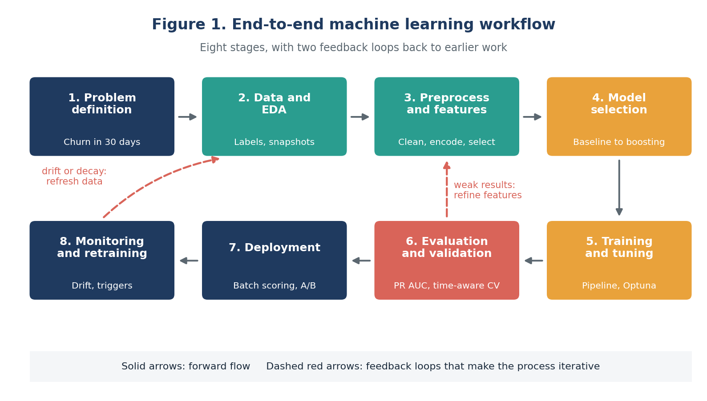
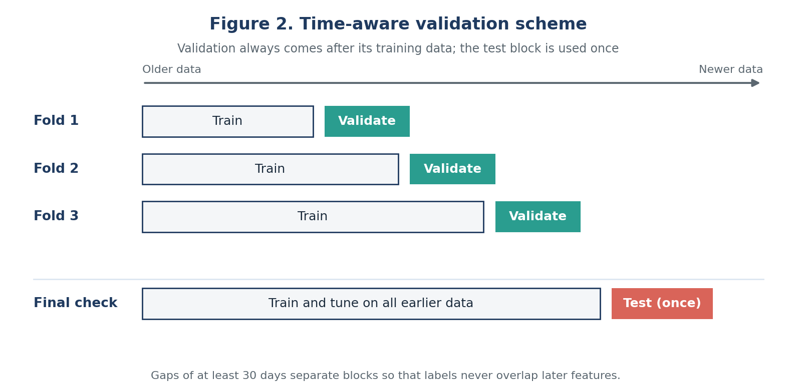
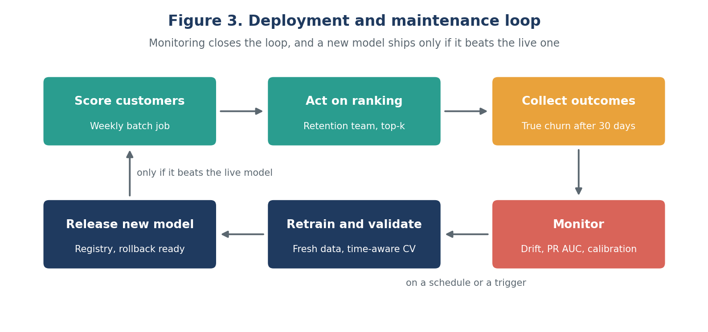

# Customer Churn Prediction: ML Model Development and Evaluation Plan

Week 3 deliverable: a detailed, step-by-step Python plan for building, validating and maintaining a
**customer churn prediction model** for a hypothetical subscription business. The plan is a design
document: no code is executed, and the snippets inside it are templates.

Full document: [`docs/Week3_ML_Model_Development_Plan.docx`](docs/Week3_ML_Model_Development_Plan.docx)

## Problem
Rank customers by their probability of cancelling in the **next 30 days**, so a limited retention budget
can be focused on the highest-risk customers. This is a binary classification task that outputs a
calibrated probability.

## What the plan covers
1. Introduction and problem definition
2. Data collection and understanding (sources, label and snapshot design, EDA)
3. Data preprocessing (cleaning, encoding, feature engineering, feature selection)
4. Model selection (logistic regression baseline, decision tree, random forest, gradient boosting, MLP)
5. Training and hyperparameter tuning
6. Evaluation metrics (confusion matrix, precision, recall, F1, ROC AUC, PR AUC, recall at top-k, calibration)
7. Validation strategy (time-aware cross-validation and a one-time final test)
8. Deployment and maintenance (batch scoring, monitoring, retraining)
9. Risks, effort plan (33 hours) and quality checklist

## Machine learning workflow


## Time-aware validation


## Deployment and maintenance loop


## Tech stack
pandas, scikit-learn, LightGBM, Optuna, MLflow, SHAP

## Repository structure
```
docs/     Week 3 plan (Word)
images/   workflow, validation and deployment diagrams
```

## Status
Planning phase complete (Week 3). Implementation to follow in later weeks.
